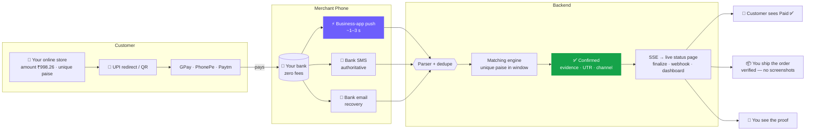
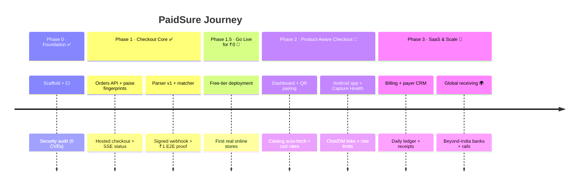

<div align="center">


<a href="https://github.com/aravind220806/Paid_Sure">
  
</a>

<br>

[](LICENSE)
[](https://nodejs.org)
[](https://react.dev)
[](https://kotlinlang.org)
[](#-roadmap--progress-checklist)

<br>

**[🚀 Quick Start](#-quick-start)** &nbsp;·&nbsp; **[🎯 Vision](#-vision--goals)** &nbsp;·&nbsp; **[👥 Who It's For](#-who-its-for)** &nbsp;·&nbsp; **[⚖️ Other Gateways vs PaidSure](#-other-gateways-vs-paidsure)** &nbsp;·&nbsp; **[✨ Features](#-features)** &nbsp;·&nbsp; **[⚙️ How It Works](#️-how-it-works)** &nbsp;·&nbsp; **[🧩 Matching](#-the-hard-question-which-payment-belongs-to-which-order)** &nbsp;·&nbsp; **[☁️ Cloud or Self-Host](#-cloud-or-self-host)** &nbsp;·&nbsp; **[🤖 One-Paste AI Setup](#-one-paste-ai-setup)** &nbsp;·&nbsp; **[✅ Progress](#-roadmap--progress-checklist)** &nbsp;·&nbsp; **[❓ FAQ](#-faq)**

</div>

<br>

## 🧭 At a Glance

PaidSure is a **UPI payment gateway made for small online product sellers**: your website creates the order, your customer pays in any UPI app, and the sale is finalized only after the money is **verified in your own bank** — zero gateway fees, instant settlement, no contract.

| | |
|---|---|
| 💰 **Cost** | ₹0 per transaction. A sale of ₹499 shouldn't lose ₹10–15 to gateway fees. Funds settle straight into your own UPI ID (VPA). |
| 🌐 **Integration** | Paste one link/button, or call one REST API. Works with any site builder, WordPress, or custom code — any stack. |
| 🏦 **Money** | It's your bank account, not ours. Nothing is held back for days: the customer's payment *is* your money, immediately. |
| 🔐 **Trust** | A sale is finalized only after the credit is verified from payment evidence (UTR, amount, channel) — never from the customer's screen. |
| 🔢 **Matching** | Every open order gets its own paise fingerprint (₹998.26) — automatically widened up to ₹3.00 when traffic is heavy, so simultaneous payments can never be confused. The identifier is part of the payment, not a fee. |
| 🛒 **Product-aware** | *(Phase 2)* Sync your product list once and every cart fills with the correct names and rates automatically — no manual amounts again. |
| 🇮🇳 **Built for** | Small online product sellers in India — the audience the big gateways price out. |

---

## 🎯 Vision & Goals

> [!NOTE]
> **Vision:** Every small online seller should get payment checkout as good as a big marketplace — verified, automatic, and free.

**Why this matters.** Big gateways are built for big merchants: per-transaction fees, KYC paperwork, settlement delays, SDKs that assume a dev team. When you sell products online and your margin on a sale is ₹50, a ₹10 gateway fee plus a 3-day settlement wait hurts. The alternative today — manual UPI and screenshot checks — invites fraud. PaidSure is the third path: **your website, your products, your bank, and a gateway that only flips a switch when the money is verified.**

**Goals**

- 🛒 **Make selling online self-serve.** A pasted button for simple sites; one `POST /api/orders` for real code. Both get the same verified checkout.
- 🧾 **Make the checkout know your products.** Catalog sync feeds product names and rates into the cart automatically (Phase 2).
- 🎯 **Make the finalize step trustworthy.** Server-side verification makes a fake success screen worthless.
- 🔌 **Keep checkout provider-free.** No PSP contract, no MDR, no settlement window, no KYC to start.
- 🔁 **Stay reliable when things break.** Three independent capture channels so one failure never blocks confirmations.
- 🧠 **Be easy to extend.** A new bank is a new parser rule, not a rebuild.

---

## 👥 Who It's For

| Audience | What PaidSure gives them |
|---|---|
| 🛍️ **Small online product sellers** *(primary)* | A real checkout for a small shop: product links that open any UPI app pre-filled, confirmed automatically, money straight to their bank |
| 🌐 **Anyone building a website with products** | One API call → redirect → verified webhook; no gateway contract needed to start |
| 💬 **Social sellers (DM / chat orders)** | Shareable checkout links that confirm themselves — no screenshot trust |
| 🧑‍💻 **Developers & contributors** | A clean REST checkout API callable from any stack, with a hosted live-status page included |

---

## ⚖️ Other Gateways vs PaidSure

**What other gateways ask from a small online seller:**

| What other gateways do | What it costs you |
|---|---|
| 💳 Charge per transaction (typically ~2% + platform fees) | ₹499 sale → ~₹10–15 gone, every single sale |
| 🕐 Hold your money in settlement windows | You ship today; the money arrives days later |
| 📄 KYC, agreements, approvals before you can test | Selling starts *next week*, not today |
| 🧩 SDKs and keys that assume a developer on the payroll | Simple sites are left out |
| 🤳 Accept the customer's success screen as proof | Fake screenshots become *your* loss |
| 🔒 Decide your pricing on their pricing page | Fees grow as you grow |

**What PaidSure does instead:**

| | PaidSure |
|---|---|
| 💸 Fees | **₹0 — money moves directly to your VPA on public UPI rails** |
| ⏱️ Settlement | **None. The customer's payment lands in your bank instantly** |
| 📝 Signing up | **Your UPI ID is the merchant account. No PaidSure-owned account exists** |
| 🌐 Integration | **One pasted link/button, or one API call — your choice** |
| 🎭 Fake screenshots | **Worthless. Only verified credit evidence on the paired phone finalizes an order** |
| 🔢 Amounts | **Every open order gets its own paise fingerprint (₹998.26), auto-widening up to ₹3.00 at busy times — no two open orders can share an amount, so every credit maps to exactly one order** |
| 🧾 Prices in the cart | *(Phase 2)* **Synced from your catalog — rates are computed server-side, customers can't edit them** |
| 📜 Open source | **MIT. Self-host the whole gateway on your own machine for free, forever** |

> [!IMPORTANT]
> **PaidSure acts like a gateway for your website — checkout, verification, finalization — but never holds or moves money.** It's not a licensed PSP, so no fees flow through it: funds go card-free and intermediary-free, straight from the customer's UPI app to your bank.

---

## ✨ Features

<table>
<tr>
<td width="33%" valign="top">

### 🌐 Drop-in checkout
One API call returns the UPI redirect link, the QR and a hosted status page — for any website or stack.

</td>
<td width="33%" valign="top">

### ↪️ Redirect flow
The customer opens GPay / PhonePe / Paytm pre-filled with the exact amount, pays, and lands back on your site.

</td>
<td width="33%" valign="top">

### 🔒 Verified finalize
A sale is finalized only from server-side verified evidence — never from the customer's screen.

</td>
</tr>
<tr>
<td width="33%" valign="top">

### 📡 Status + webhook
Live SSE status on the hosted page, plus a REST endpoint and webhook so your backend can finalize the order.

</td>
<td width="33%" valign="top">

### 🛒 Product-aware cart *(Phase 2)*
Sync your product names and rates once; carts self-fill and totals are computed server-side — no manual amounts.

</td>
<td width="33%" valign="top">

### 💬 Shareable checkout links
Per-order payment links for chat and DM sales that confirm themselves.

</td>
</tr>
<tr>
<td width="33%" valign="top">

### 🚨 Capture Health
Self-healing capture engine: heartbeats, 🟢🟡🔴 status, failure alarms and a **FIX NOW** wizard verified by a ₹1 self-test.

</td>
<td width="33%" valign="top">

### 🕒 Late-match window
A payment that arrives late still links to its order within **12 hours**.

</td>
<td width="33%" valign="top">

### 🧾 Evidence ledger
Raw SMS/push, UTR, VPA and channel stored per payment. Unmatched credits are never lost.

</td>
</tr>
</table>

---

## ⚙️ How It Works

Every order passes through four steps:

1. **Your website creates the order.** One call to `POST /api/orders` returns the amount with a unique paise fingerprint (₹998.**26**; the identifier widens automatically, up to ₹3.00, on busy days), a `upi://` redirect link, a QR and a hosted live-status page. *(No code? Paste a checkout link instead.)*
2. **The customer pays.** Your site redirects them — or shows the QR — and any UPI app (GPay, PhonePe, Paytm) opens pre-filled with the amount. They return to your site.
3. **The payment self-reports.** Your paired capture phone collects the credit evidence: business-app push, bank SMS or bank email. *(The ~1–3 s fast lane needs a UPI business app with its payment notifications ON — see [What you need](#-what-you-need). SMS/email keep working without it.)*
4. **PaidSure verifies and you finalize.** A unique-amount match marks the order PAID with evidence stored (UTR, VPA, channel); your backend reads the status (REST) or the webhook/SSE and ships the product.



---

## 🧩 The Hard Question: Which Payment Belongs to Which Order?

Imagine three customers buying the same ₹998 t-shirt at the same moment. Three ₹998 credits land in the merchant's bank. The bank alert says only *"₹998 credited"* — never *"for order PS-000421"*.

> **The problem.** If every order costs the same, there is no way to tell which bank credit belongs to which customer. Names repeat, screenshots can be faked, and bank messages say different things.

PaidSure solves this with a **paisa fingerprint**: a tiny, private amount added to every order.

### 💡 Our solution: every order gets its own private paise

Each order gets a unique amount built from the product price plus a small **paisa fingerprint**. The range grows automatically with traffic:

| Traffic | Fingerprint range | Example on a ₹998 product |
|---|---|---|
| Normal | **₹0.00–₹0.99** | ₹998.26 |
| Busy | **₹1.00–₹1.99** | ₹999.04 |
| Peak | **₹2.00–₹3.00** | ₹1000.58 |

That is **301 different amounts at the same price point** (₹998.00 through ₹1001.00), each one unique for that merchant inside the safety window. The allocator always fills the cheapest band first, so a quiet shop only adds ₹0–₹0.99. When the cheap band is full, it opens the next one automatically — no setting to change and no redeploy.

> [!NOTE]
> Prices within ₹3 of each other share part of the same paise space, so 301 is the maximum for one isolated price — not 301 for every product at once. The allocator sees the overlap and will never reuse an amount; nearby price points simply consume the shared slots.

| Order | Product price | Amount the customer pays | What the bank alert says | Which order it confirms |
|---|---|---|---|---|
| `PS-000421` | ₹998 | **₹998.26** | "Rs 998.26 credited…" | ✅ only `PS-000421` |
| `PS-000422` | ₹998 | **₹998.71** | "Rs 998.71 credited…" | ✅ only `PS-000422` |
| `PS-000423` | ₹998 | **₹998.08** | "Rs 998.08 credited…" | ✅ only `PS-000423` |

No two orders at the same shop may share an amount inside the safety window. So when a credit arrives, the matcher asks one simple question:

> **"Which order has exactly this amount in paise?"**

If exactly one does → that order becomes **PAID**, with the bank evidence attached. No guessing, no name matching, no screenshots.

> [!IMPORTANT]
> **The extra paise is not a fee.** It is part of the payment and lands in the seller's account with the rest. Think of it as the order number written on the envelope: ₹998.26 is "the ₹998 order with tag 26". The hosted checkout always shows the final amount before the customer pays, so nobody is surprised.

**For non-technical sellers:** the customer pays ₹998.26 instead of ₹998.00. The ₹0.26 identifies the order and reaches your bank account — PaidSure never keeps it. On a busy day the identifier can grow to at most ₹3.00, and the checkout always shows the exact amount before payment.

### 🧮 How the fingerprint is chosen (for developers)

For every new order:

1. Convert the product total to paise: ₹998 → `99800`.
2. Find every order for this merchant whose amount falls between `basePaise` and `basePaise + 300` and is still inside the safety window (open, or recently paid/closed — see below).
3. Pick a free offset, cheapest band first: `0…99`, then `100…199`, then `200…300`. The next band is enabled as pressure rises (above 80 and 180 occupied slots), so a burst never needs a config change — but the allocator never makes a customer pay more while a cheaper tag is free.
4. Store `amountPaise = base + offset`, `baseAmountPaise = base` and `extraPaise = offset`; build the UPI link with `am=998.26`.
5. If all **301** offsets are taken, return a clean `503 fingerprint_space_exhausted` with `Retry-After: 60`. Never reuse an amount.

```
₹998.00 base → 301 possible amounts
  0…99     ₹998.00 – ₹998.99    normal traffic
100…199   ₹999.00 – ₹999.99    busy traffic
200…300   ₹1000.00 – ₹1001.00  peak traffic
```

**Worked example.** 105 simultaneous orders at ₹998:

- the first 100 get ₹998.00–₹998.99
- the next 5 get ₹999.00–₹999.04
- at 301 orders the whole range is in use; the 302nd gets `503` instead of a duplicate amount

**Why stop at ₹3.00?** It is the largest identifier that still reads as small change on a normal product price. A bigger range would look like a surcharge, create refund questions, and fall hardest on low-priced items. 301 slots cover a small seller's realistic burst at one price. If a shop regularly needs more, the right next step is another receiving VPA or a queue — not silently charging more. Both are future work, not shipped features.

### 🔒 Why an amount is not reused immediately

A fingerprint's job does not end when the order is paid. A bank can deliver the same credit twice, a customer can pay late, or a second payment can arrive after the first. If the amount were freed immediately, that duplicate could confirm a different order — and the seller would ship goods that were never paid for.

So every amount stays reserved:

- A **PENDING** order holds its amount for the merchant's late-match window (`lateMatchMinutes`, default **12 hours**).
- A sweeper closes it after that window, so old checkout links stop blocking capacity forever.
- A **paid or closed** order's amount stays reserved for another 12 hours after its last update, giving late and duplicate credits a full safety buffer before reuse.

In practice an expired order's amount becomes reusable roughly 24 hours after creation: 12 hours open plus 12 hours retired. A paid order's amount is held for 12 hours after payment. In exchange, a duplicate credit can never silently confirm a new order.

**Database guarantee.** Allocation and order creation run in one transaction. A partial unique index on `(merchantId, amountPaise)` for `PENDING` orders catches any race that slips through, and the API retries with a fresh pick. SQLite (dev) serialises order writes in-process because it allows only one writer; PostgreSQL (production) runs concurrently. A PostgreSQL load test is still on the checklist — the SQLite path is stress-tested with 301 live orders, 20 parallel creates and duplicate-credit replay.

### 🧾 What happens in the real world

| Situation | What PaidSure does |
|---|---|
| 50 people pay at the same second | 50 different amounts → 50 messages → each matches exactly one order |
| Two different shops use ₹998.26 | No conflict — matching is scoped to the merchant whose phone captured the credit |
| The same bank SMS arrives twice | Dedupe fingerprint → the second copy is ignored; the order stays paid once |
| A customer pays twice for one order | The first credit confirms it; the second matches no open order → **unmatched ledger**, visible for refund. The amount stays reserved, so it cannot confirm a new order |
| A customer ignores the link and pays a round ₹998.00 | Matches only if ₹998.00 is that order's assigned fingerprint (offset 0). Otherwise it goes to the **unmatched ledger** for manual assignment or refund |
| A payment arrives hours late | The late-match window still links it for **12 hours** |
| 100 orders at ₹998 are open at once | All 100 cheap tags are used; the 101st moves to ₹999.xx automatically |
| 301 orders at ₹998 are open at once | The full ₹998.00–₹1001.00 range is used; the 302nd gets a clean `503`, never a duplicate amount |
| A paid order is followed by a duplicate credit | The amount is still retired, so the duplicate cannot confirm a new order |

### 🤔 Why not match by payer name or a screenshot?

| Signal | Can it confirm a payment? | Why |
|---|---|---|
| **Paisa fingerprint** | ✅ Yes | Chosen by us, unique among all orders inside the safety window, and present in every bank credit |
| Payer name | ⚠️ No, evidence only | Names repeat, get masked, differ from the order name, or the payment comes from a family member's app |
| Payer VPA | ⚠️ Not alone | Customers rarely know it by heart; banks do not always include it |
| Customer's success screen | ❌ Never | A screenshot proves nothing — only a real credit in the merchant's bank counts |
| UTR | ✅ As evidence | Perfect for audit and support, but the customer does not have it before paying |

PaidSure still **stores** payer hints, VPA, UTR and the raw message text as evidence — they help with support, refunds and disputes. They are never the confirmation key.

### 🧑‍💼 What the customer sees

```
Pay ₹998.26
Includes ₹0.26 to identify your order.
It goes to the seller — not a fee.
```

One clear line, and the amount is pre-filled in GPay / PhonePe / Paytm. The customer taps once and pays; the status page flips to **PAID** on its own.

---

## ☁️ Cloud or Self-Host

Same code, two ways to run it — pick the one that fits how you sell:

| | ☁️ **Cloud (Model A)** | 🖥️ **Self-Host (Model B)** |
|---|---|---|
| Who runs the gateway | The hosted PaidSure instance — sign up, paste your VPA, done | **You** — clone this repo and run it on your own machine or server |
| Who has the data | The hosted instance | **Your machine. Your database, your rules** |
| Effort | Minutes | ~10 minutes with the [AI setup prompt](#-one-paste-ai-setup) below |
| Cost | Free tiers | ₹0 — any computer you already own; your existing server can host it beside your website |
| Best for | Sellers who just want a link that works | Sellers who want full control, privacy, or to run it on their own hosting |

> [!NOTE]
> **Security rule in both models:** the Android helper never talks to the database — it talks only to the gateway's API with a signed device token. Database credentials live on the server, in one place, never inside any app.

---

## 🤖 One-Paste AI Setup

Don't want to follow the steps yourself? Copy the box below and paste it into any AI coding assistant (Claude Code, Cursor, Copilot, or a chat agent with access to your computer). It clones the project, sets everything up, connects your store, and proves it works — asking you only what only you can answer.

```text
Set up PaidSure for me — the free open-source UPI payment gateway from
https://github.com/aravind220806/Paid_Sure

PaidSure lets a small online product seller accept UPI payments on their
website with zero transaction fees. Money goes directly to MY UPI ID.
This tool only confirms that the money arrived. Never do anything that
costs money. If a step asks for a card or payment details, STOP and tell me.

Work on this computer and do these steps in order. Say each step in one
short, simple sentence before you do it, so I always know what's happening:

1. CLONE — Download the project into a folder named "PaidSure".
2. INSTALL — Install everything it needs (check that Node.js 20+ exists
   first; if missing, tell me how to install it).
3. PREPARE THE DATABASE — Create a local database file and a settings file
   with three randomly generated secrets. Keep my settings on this computer
   only; never print them or send them anywhere.
4. START THE GATEWAY — Start it and check the health page says ok. If
   something fails, read the error, fix it, and retry yourself.
5. START THE DASHBOARD — Start the website part and give me the exact
   address to open in my browser.
6. ASK ME ONLY WHAT ONLY I KNOW:
   - My store name
   - My UPI ID (where I receive money, like name@okaxis)
   - Do I have my own website, or should I use PaidSure's hosted pages?
7. CONNECT THE CHECKOUT:
   - If I have a website: add the smallest working example to MY website
     (match its language and framework) so it creates an order, sends the
     customer to the UPI app, and finalizes when PaidSure reports the
     payment as verified.
   - If I have no website: show me how to create an order and a checkout
     link from the dashboard.
   - If my website lists products with prices: also prepare a product list
     file (name, price, product link) so the catalog sync in Phase 2 can
     consume it — see the Roadmap section.
8. CONNECT MY PHONE — Walk me through installing the "PaidSure Alerts"
   Android app on the phone that receives my bank SMS, and scanning the
   pairing code from the dashboard. Wait for me to finish.
9. PROVE IT WORKS — Create a ₹1 test order, have me pay it from any UPI
   app, and confirm the order flips to PAID by itself. Show me the payment
   proof on screen.

RULES:
- Ask questions ONLY when only I can answer (my UPI ID, my choices). Fix
  everything else yourself.
- Keep all passwords, keys and tokens on this computer only.
- Never connect any mobile app directly to the database — apps talk only
  to the gateway's API.
- When done, give me a simple one-page summary:
  (a) what is running where, (b) how to start it next time,
  (c) how to update it with one command, (d) where to get help.
```

---

## 🧱 Tech Stack

| Layer | Technology | Role |
|---|---|---|
| **Backend** | Node · Express · TypeScript | Orders, intent/QR, ingest, live updates |
| **Database** | Prisma · SQLite (dev) / PostgreSQL (prod) | Merchants, products, orders, evidence, parser rules |
| **Parser** | Rule-based patterns | Adds a new bank with a rule, not a rebuild |
| **Frontend** | React · Vite | Hosted checkout, live status page, dashboards |
| **Android** | Kotlin | Notification listener, SMS receiver, alarms, TTS |
| **Realtime** | Server-Sent Events | Live status and confirmation feeds |

---

## 📊 Performance Targets

| Metric | Target | How |
|---|:---:|---|
| ⚡ Fast-lane confirmation | **< 3–5 s** | Business-app notification capture |
| 📩 Fallback confirmation | **< 60 s** | Bank SMS parser |
| 🔋 Battery impact | **< 1.5% / day** | Event-driven design, quiet-hour throttling |
| 🛒 Same-price burst | **301 orders per price point inside the safety window** | 301 unique paise amounts (₹0.00–₹3.00), cheapest band first, automatic widening under load; clean `503` beyond the cap |

---

## 🛡️ Security & Privacy

- **Consent first.** The Android helper reads a merchant's own notifications and SMS only with their consent, and only as payment evidence.
- **Evidence stays with the merchant.** Raw messages are used to confirm payments and never shared.
- **Pairing tokens.** Devices pair with the dashboard using signed device tokens, stored hashed server-side.
- **Redacted samples.** Bug reports ask for SMS samples with names removed.

---

## ✅ Roadmap & Progress Checklist

### Done

**Phase 0 — Foundation**
- [x] Monorepo scaffold (backend / frontend / android), design tokens, CI pipeline
- [x] Security audit: 0 CVEs, CORS allowlist deny-by-default, security headers, production boot guard
- [x] README, license, contributing guide, bank-format documentation

**Phase 1 — The checkout core**
- [x] **Traffic-aware paisa-fingerprint allocator** — 301 unique amounts per price point (₹0.00–₹3.00), cheapest band first, widening automatically under load, unique per merchant inside the safety window
- [x] **Atomic allocation + order creation** — one database transaction, partial unique index on `(merchantId, amountPaise)` for `PENDING` orders, retry on conflict (SQLite dev writes are serialised)
- [x] **Expired-order sweeper** — closes stale checkout links after the late-match window while keeping their amount retired, so capacity cannot leak
- [x] **`POST /api/orders`** — merchant API-key auth, human refs (`PS-000421`), `upi://` intent URL, order expiry
- [x] **`GET /api/orders/:ref`** — public status + verified evidence (UTR, source, paid time)
- [x] **`GET /api/orders/:ref/events`** — live SSE status stream
- [x] **Hosted checkout / status page** at `/s/:ref` — amount, QR, "Open any UPI app", auto-flips to PAID with proof
- [x] **`POST /api/ingest`** — the one doorway for paired phones: hashed device tokens, per-message dedupe
- [x] **Parser v1** — HDFC, SBI, ICICI, Axis SMS + GPay / PhonePe / Paytm business-app pushes + generic per-lane fallbacks
- [x] **Matching engine v1** — unique-amount match + match window + strict mode, race-safe one-time claim, late-match ledger
- [x] **`order.paid` webhook** — HMAC-SHA256 signed, delivered to the merchant's backend
- [x] **Admin bootstrap** — create merchant + pair a phone (merchant dashboard UI arrives in Phase 2)
- [x] **43 automated tests** — money math, fingerprint bands, allocator, sweeper, parser, UPI builder, matcher
- [x] **Live capacity verified** — 301 unique amounts at one price, 302nd returns `503` with `Retry-After`, 20 parallel creates, duplicate credit stays unmatched

### Next

**Phase 1.1 — Production concurrency & capacity**
- [ ] PostgreSQL load test: simultaneous same-price orders against the production database
- [ ] Capacity alert when a price point crosses ~80% of its 301 amounts
- [ ] Burst handling for sellers who regularly hit the cap — multiple receiving VPAs or queueing

**Phase 1.5 — Go live for ₹0**
- [ ] Deploy frontend to Vercel, backend to Render, database to Neon (free tiers)
- [ ] First real store, real phone pairing, ₹1 live test

**Phase 2 — Product-aware checkout**
- [ ] Merchant dashboard UI (sign-up, API keys, orders, device QR pairing, capture health)
- [ ] Catalog auto-fetch + approval screen; server-side cart rates
- [ ] Shareable per-order checkout links (chat/DM) + branded QR
- [ ] Android app implementation (capture, queue, heartbeat) + Capture Health / FIX NOW wizard
- [ ] Rate limiting on public routes

**Phase 3 — SaaS & scale**
- [ ] Billing, payer CRM, daily ledger
- [ ] Global receiving rails (beyond India)



---

## 📋 What You Need

PaidSure doesn't process money, so getting paid-ready needs **your own accounts plus one phone**:

| # | Requirement | Why |
|---|---|---|
| 1️⃣ | **A current (business) bank account with your own UPI ID (VPA)** — e.g. `yourstore@okaxis` | Checkout funds settle directly here. Business income belongs on a business account — see [why below](#-why-a-business-account-not-personal). |
| 2️⃣ | **A bank that sends credit SMS/alerts** | The authoritative confirmation lane. |
| 3️⃣ | **One Android phone** (the receiving/SIM phone) | Runs **PaidSure Alerts**, the capture engine — event-driven, ~1.5% battery/day. |
| 4️⃣ | **A UPI business app with notifications ON** — Google Pay for Business, PhonePe Business or Paytm for Business, holding your VPA, with "payment received" notifications enabled | This is the **fast lane**: "you received ₹X" pushes in ~1–3 seconds. |
| 5️⃣ | **PaidSure Alerts paired** (dashboard QR pairing) | Captures push + SMS evidence and reports device health. |

> [!IMPORTANT]
> **Notifications ON is the one switch that makes PaidSure instant.** If it's ever off, you don't lose correctness — bank SMS and bank email still confirm (slower) — and **Capture Health** catches the silence, sounds the alarm, and the **FIX NOW** wizard deep-links to the exact settings screen, proving recovery with a ₹1 self-test.

### 🏦 Why a Business Account (Not Personal)

A personal bank account is designed for personal money: salary in, expenses out. Online selling is a different pattern — **dozens of small credits arriving daily from many different people**. Banks watch for exactly this, and when it shows up on a *personal* account, the usual outcomes are UPI disabled, transactions held for review, or the account **frozen pending verification** — with your sales money locked inside while you collect paperwork.

| Setup | What a small online seller experiences |
|---|---|
| ❌ Personal account receiving business payments | Flagged inflow pattern → UPI/cards blocked or account frozen until the income is verified — sales money stuck at the worst moment |
| ✅ Current (business) account + business UPI app | Heavy small-ticket inflow is *the* expected pattern → no flags, higher receiving limits, statements that work for accounting and taxes |

Setting up the business side also brings the business apps (Google Pay for Business, PhonePe Business, Paytm for Business), which are:

- **Free** to set up — and receiving UPI on them costs **₹0**. No per-transaction charges, no platform fees.
- **Home of the fast lane** — the "You received ₹X" notification PaidSure reads in ~1–3 seconds.
- **Built on your current-account VPA** — one setup, a lifetime of sales.

> [!NOTE]
> **Why this matters to PaidSure's design:** the match window and evidence rules work the same for a local or an international buyer — verification just reads your bank's credit evidence, wherever the payer's money came from.

### 🌍 Customers From Anywhere (Roadmap)

- **Payer side — already global today:** UPI International lets customers abroad pay to your VPA/QR from a growing list of countries (Singapore, UAE, France and more, via partner apps). PaidSure's checkout just creates the order — identical whether the customer sits next door or abroad.
- **Receiving side — India today, global next.** The capture engine (bank SMS/push parsers, PaidSure Alerts) is built for Indian banks and business apps first. Extending the receiver toolkit to other countries' banks and payment rails is on the roadmap (Phase 3).

---

## 🚀 Quick Start

### Prerequisites
- Node.js **20.x or newer**
- A database Prisma supports — **SQLite for quick dev**, PostgreSQL for production
- For live end-to-end: the items in [📋 What you need](#-what-you-need) — a VPA and a capture phone with a UPI business app (notifications ON)
- Not needed for your first local requests

### 1️⃣ Backend
```bash
git clone https://github.com/aravind220806/Paid_Sure.git
cd Paid_Sure/backend
npm install
cp .env.example .env          # set DATABASE_URL, JWT_SECRET, DEVICE_TOKEN_SECRET
npx prisma db push            # quick dev setup (SQLite)
npm run dev                   # → http://localhost:4000
```

### 2️⃣ Hosted checkout & dashboard (frontend)
```bash
cd ../frontend
npm install
npm run dev                   # → http://localhost:5173
```

### 3️⃣ Create your merchant + API key *(admin bootstrap)*
```bash
curl -X POST http://localhost:4000/api/admin/merchants \
  -H 'Content-Type: application/json' \
  -H 'x-admin-password: dev-admin-password' \
  -d '{"name":"Your Store","slug":"your-store","vpa":"yourstore@okaxis","payeeName":"Your Store"}'
# → { "apiKey": "psm_…", "webhookSecret": "…" }   ← shown once, store safely
```

### 4️⃣ Create an order (your website does this server-side)
```bash
curl -X POST http://localhost:4000/api/orders \
  -H 'Content-Type: application/json' \
  -H 'Authorization: Bearer psm_…' \
  -d '{"amount":998,"note":"2 × Graphic Tee"}'
# → {
#     "order": {
#       "ref":             "PS-000421",
#       "amount":          "998.26",       ← ₹998 + 26 paise fingerprint
#       "baseAmount":      998,
#       "baseAmountPaise": 99800,
#       "extraPaise":      26,             ← 0–300; part of the payment, not a fee
#       "intentUrl":       "upi://pay?pa=yourstore@okaxis&am=998.26&cu=INR…",
#       "statusUrl":       "http://localhost:5173/s/PS-000421"
#     }
#   }
#   The fingerprint is unique among orders inside the safety window. It
#   identifies the order in the bank credit and is automatically widened
#   (up to ₹3.00) when many orders share the same price.
```
Redirect the customer to `intentUrl` (or render `statusUrl` as a QR). When
they return from the UPI app, your backend reads the status endpoint or
receives the `order.paid` webhook and finalizes — always server-side.

### 5️⃣ Pair the capture phone
```bash
curl -X POST http://localhost:4000/api/admin/merchants/your-store/devices \
  -H 'Content-Type: application/json' \
  -H 'x-admin-password: dev-admin-password' -d '{}'
# → { "pairToken": "psd_…" }   ← paste into the PaidSure Alerts app (Phase 2)
```
Then open `http://localhost:5173/s/PS-000421` — amount, QR, and a live
status that flips to **PAID** the moment the matching credit is verified.

<details>
<summary><b>🔧 Environment variables</b></summary>

<br>

| Variable | Used by | Description |
|---|---|---|
| `DATABASE_URL` | Backend | SQLite file (dev) or PostgreSQL DSN (prod) |
| `JWT_SECRET` | Backend | Merchant dashboard sessions |
| `DEVICE_TOKEN_SECRET` | Backend | Android capture-pairing tokens |
| `ADMIN_PASSWORD` | Backend | Platform admin access |
| `PUBLIC_APP_URL` | Backend | Frontend base URL for `/s/<ref>` status links |
| `VITE_API_URL` | Frontend | Backend base URL (dev uses the Vite proxy) |

</details>

---

## 📁 Project Structure

```
paid-sure/
├── backend/                 # Express API
│   ├── src/routes/          # orders · ingest · webhooks · admin
│   ├── src/services/        # amount-engine · parser · matcher · evidence
│   └── src/db/              # Prisma schema + migrations
├── frontend/                # React (Vite)
│   ├── src/pages/store/     # customer checkout + live status
│   ├── src/pages/dashboard/ # merchant + platform admin
│   └── src/design/          # design tokens
├── android/                 # PaidSure Alerts (Kotlin)
│   ├── capture/             # notification listener + SMS receiver
│   ├── alert/               # alarms · TTS · auto-fix wizard
│   └── net/                 # ingest client · offline queue · heartbeat
└── docs/                    # bank SMS formats · architecture · banner.svg
```

---

## ❓ FAQ

<details>
<summary><b>Is PaidSure a payment gateway?</b></summary>

<br>

For your website it **behaves like one**: an order API, a UPI redirect checkout, a status endpoint and a finalize webhook. The difference is underneath — it's not a licensed PSP, so money never passes through it. Payments settle straight into the merchant's own VPA: no MDR, no settlement window, no KYC to start testing.

</details>

<details>
<summary><b>What happens after the customer returns?</b></summary>

<br>

Your site lands them on a hosted live-status page (SSE). Under the hood, PaidSure matches the verified credit evidence to the order and flips it to PAID — your backend reads that through the status REST endpoint or the finalize webhook, then ships the goods. The customer's screen is never treated as proof.

</details>

<details>
<summary><b>What if notifications are turned off?</b></summary>

<br>

Bank SMS and bank email keep working without notification access. Capture Health detects the silence and raises an alarm. The FIX NOW wizard opens the right settings screen and confirms recovery with a ₹1 self-test.

</details>

<details>
<summary><b>Can a customer fake it?</b></summary>

<br>

No. The customer's screen is never used as a signal. Only an alert received on the **merchant's own paired phone** can confirm an order, and a credit can only confirm the order with the **same unique amount**. Every order carries its own ₹0.00–₹3.00 paise fingerprint (cheapest band first, widened automatically under load), so a ₹998.26 credit can only belong to the order created for ₹998.26 — a screenshot or a ₹1 transfer has nothing to match.

</details>

<details>
<summary><b>Why does the customer pay a few extra paise?</b></summary>

<br>

The paise amount is the order's identifier in the bank credit — the only matching key. It is **not a fee**: 100% of it reaches the seller. PaidSure uses ₹0.00–₹0.99 in normal traffic and widens the range up to ₹3.00 only when many orders share the same price. The checkout always shows the final amount before the customer pays.

</details>

<details>
<summary><b>What if more than 301 people order the same price at once?</b></summary>

<br>

The order API returns `503 fingerprint_space_exhausted` with `Retry-After: 60`. No duplicate amount is issued and no wrong order can be confirmed; the seller's site can ask the customer to retry in a minute. Capacity alerts and burst handling (multiple receiving VPAs or queueing) are on the roadmap, not shipped yet.

</details>

<details>
<summary><b>Why not just use Razorpay?</b></summary>

<br>

Gateways are priced for high volume — but if your whole margin on a ₹499 sale is ₹50, a ~2% fee plus settlement days is a real cost. PaidSure exists for the sellers those pricing pages ignore: direct-to-VPA checkout at ₹0 per transaction, confirmed by verified bank evidence. It can also coexist with an existing gateway — it's just the UPI checkout + verification layer.

</details>

<details>
<summary><b>Do I need a developer to set this up?</b></summary>

<br>

No. Simple sites use the paste-a-link tier (no code), and self-hosting is a one-paste job for an AI assistant — see [One-Paste AI Setup](#-one-paste-ai-setup). The API tier is there when you want code.

</details>

---

## 🤝 Contributing

Contributions are welcome. The easiest high-value contribution is a **parser rule for a new bank**. See [`docs/bank-formats.md`](docs/bank-formats.md).

> [!TIP]
> Bug reports that include a **raw sample SMS** (with names redacted) are the most helpful kind.

```bash
npm run lint && npm run test   # run before every PR
```

---

## 📜 License & Disclaimer

Released under the [MIT License](LICENSE).

> [!CAUTION]
> PaidSure is **not** a licensed Payment Service Provider and does not touch NPCI rails. It provides the checkout and verification for payments already made to the merchant's own VPA, and never holds or moves money. "UPI", "BHIM", GPay, PhonePe and Paytm belong to their respective owners.

---

<div align="center">


**UPI checkout for small online product sellers** 🛒

⭐ Star this repo &nbsp;·&nbsp; 🐛 [Report an issue](../../issues) &nbsp;·&nbsp; 💬 [Discussions](../../discussions)

</div>
