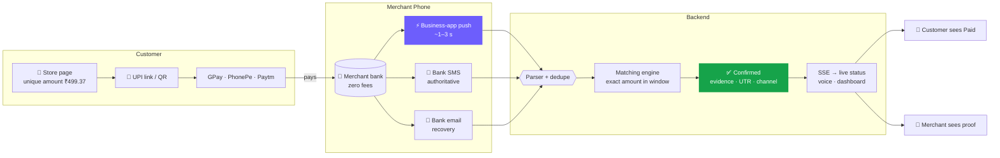
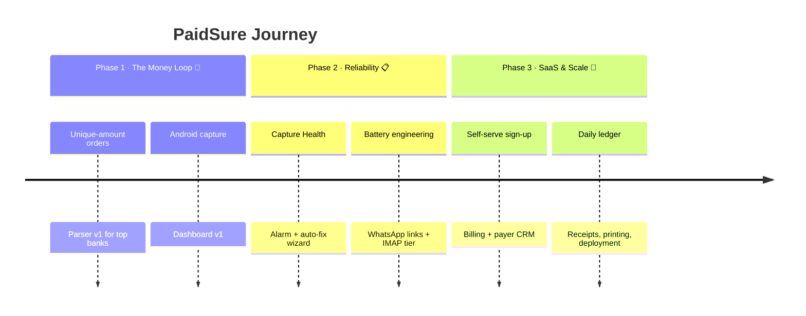

<div align="center">


<a href="https://github.com/aravind220806/Paid_Sure">
  
</a>

<br>

[](LICENSE)
[](https://nodejs.org)
[](https://react.dev)
[](https://kotlinlang.org)
[](#-roadmap)

<br>

**[🚀 Quick Start](#-quick-start)** &nbsp;·&nbsp; **[🎯 Vision](#-vision--goals)** &nbsp;·&nbsp; **[✨ Features](#-features)** &nbsp;·&nbsp; **[⚙️ How It Works](#️-how-it-works)** &nbsp;·&nbsp; **[🗺️ Roadmap](#️-roadmap)** &nbsp;·&nbsp; **[❓ FAQ](#-faq)**

</div>

<br>

## 🧭 At a Glance

PaidSure lets a small shop, stall or social seller **confirm UPI payments automatically and with proof**, without paying a gateway fee and without trusting a customer's screenshot.

| | |
|---|---|
| 💰 **Cost** | Zero transaction fees. Money goes straight to the merchant's own UPI ID (VPA). |
| 🔐 **Trust** | Only an alert on the merchant's own phone can confirm an order. |
| ⚡ **Speed** | Fast-lane confirmation in about 1–3 seconds through business-app notifications. |
| 🔋 **Battery** | Event-driven design with no polling and no wake locks. Target: under 1.5% per day. |
| 🇮🇳 **Built for** | Local merchants in India who already accept UPI. |

---

## 🎯 Vision & Goals

> [!NOTE]
> **Vision:** Every counter in India should be able to accept UPI with the same confidence a bank branch has, at no extra cost.

**Why this matters.** Most merchant payment tools either charge per transaction or rely on the merchant checking a screen by eye. Both slow down the queue and cost money. PaidSure keeps the money on the public UPI rails and adds only a verification layer.

**Goals**

- 🎯 **Stop fake-payment losses.** Make a fake success screen worthless.
- 🎯 **Remove the sound-box subscription.** Turn any Android phone into a free payment announcer.
- 🎯 **Stay reliable when things break.** Use three independent channels so one failure does not block confirmations.
- 🎯 **Be easy to extend.** A new bank is a new parser rule, not a rebuild.
- 🎯 **Grow into a SaaS platform.** Self-serve sign-up, billing, payer CRM and daily ledgers for many merchants.

---

## 👥 Who It's For

| Audience | What PaidSure gives them |
|---|---|
| 🏪 **Counter shops and kirana stores** | Auto-confirmed bills and a free voice announcement on the shop phone |
| 🛍️ **Social sellers and small brands** | WhatsApp payment links that confirm without manual checks |
| 🍽️ **Stalls, canteens and events** | Faster queues with proof for every payment |
| 🧑‍💻 **Developers and contributors** | An open, well-structured codebase with a clear path to add new banks |

---

## ⚙️ How It Works

Every payment passes through four steps:

1. **Create an order.** The store gets a unique amount for each order, such as ₹499.**37**.
2. **The customer pays.** They use a UPI intent link or QR code with GPay, PhonePe or Paytm.
3. **The merchant's phone hears about it.** The business-app push, bank SMS or bank email reports the credit.
4. **PaidSure confirms it.** An exact amount match marks the order as paid and stores the evidence: UTR, VPA and channel.



---

## ✨ Features

<table>
<tr>
<td width="33%" valign="top">

### 🔒 Screenshot-proof
Confirmation comes only from the merchant's own payment channels.

</td>
<td width="33%" valign="top">

### ⚡ Tri-lane capture
Push → SMS → email. The first match wins, and duplicates merge into one payment.

</td>
<td width="33%" valign="top">

### 🗣️ Voice announce
*"₹549 received, order 421"* is spoken on the shop phone in English, Hindi or regional languages.

</td>
</tr>
<tr>
<td width="33%" valign="top">

### 🚨 Capture Health
Device heartbeats, 🟢🟡🔴 status, failure alarms and a **FIX NOW** wizard verified by a ₹1 self-test.

</td>
<td width="33%" valign="top">

### 🔋 Battery-respectful
Event-driven with no polling and no wake locks.

</td>
<td width="33%" valign="top">

### 💬 WhatsApp links
Create an order, share the link in a chat, and it confirms by itself.

</td>
</tr>
<tr>
<td width="33%" valign="top">

### 🕒 Late-match window
A payment that arrives late still links to its order within **12 hours**.

</td>
<td width="33%" valign="top">

### 🧾 Evidence ledger
Raw SMS or push, UTR, VPA and channel are stored. Unmatched credits are never lost.

</td>
<td width="33%" valign="top">

### 🏪 Multi-merchant
Each merchant gets a store page, dashboard, devices, parser rules and a choice of strict or instant confirmation.

</td>
</tr>
</table>

---

## 🧠 Why PaidSure Is Different

> [!IMPORTANT]
> **PaidSure is a verification layer, not a payment gateway.** It never holds money. It only proves that money reached the merchant's own account.

| | PaidSure | Typical gateway | Paid sound box |
|---|:---:|:---:|:---:|
| Transaction fees | **₹0** | Per transaction | Monthly fee |
| Settlement delay | **None** | Days | None |
| Works if push is off | **✅ SMS + email** | N/A | ❌ |
| Fake screenshot can confirm | **❌ Never** | ❌ Never | ❌ Never |
| Unique amount per order | **✅** | Varies | ❌ |

---

## 🧱 Tech Stack

| Layer | Technology | Role |
|---|---|---|
| **Backend** | Node · Express · TypeScript | Orders, intent/QR, ingest, live updates |
| **Database** | PostgreSQL · Prisma | Merchants, orders, evidence, parser rules |
| **Parser** | Rule-based patterns | Adds a new bank with a rule, not a rebuild |
| **Frontend** | React · Vite | Checkout, live status, dashboards |
| **Android** | Kotlin | Notification listener, SMS receiver, alarms, TTS |
| **Realtime** | Server-Sent Events | Live status and confirmation feeds |

---

## 📊 Performance Targets

| Metric | Target | How |
|---|:---:|---|
| ⚡ Fast-lane confirmation | **< 3–5 s** | Business-app notification capture |
| 📩 Fallback confirmation | **< 60 s** | Bank SMS parser |
| 🔋 Battery impact | **< 1.5% / day** | Event-driven design, quiet-hour throttling |
| 🏪 Concurrent orders | **1,000s per merchant** | Indexed unique `(merchant, amount_paise)` allocation |

---

## 🛡️ Security & Privacy

- **Consent first.** The Android helper reads a merchant's own notifications and SMS only with their consent, and only as payment evidence.
- **Evidence stays with the merchant.** Raw messages are used to confirm payments and are not shared.
- **Pairing tokens.** Devices pair with the dashboard using signed device tokens.
- **Redacted samples.** Bug reports ask for SMS samples with names removed.

---

## 🗺️ Roadmap



---

## 🚀 Quick Start

### Prerequisites
- Node.js **20.x or newer**
- A PostgreSQL database
- Android Studio (for the helper app)

### 1️⃣ Backend
```bash
git clone https://github.com/aravind220806/Paid_Sure.git
cd paid-sure/backend
npm install
cp .env.example .env          # set DATABASE_URL, JWT_SECRET, DEVICE_TOKEN_SECRET
npx prisma migrate dev
npm run dev                   # → http://localhost:4000
```

### 2️⃣ Frontend
```bash
cd ../frontend
npm install
npm run dev                   # → http://localhost:5173
```

### 3️⃣ Android helper
Open `android/` in Android Studio, run it on the shop phone, then pair it from the dashboard QR code.

<details>
<summary><b>🔧 Environment variables</b></summary>

<br>

| Variable | Used by | Description |
|---|---|---|
| `DATABASE_URL` | Backend | PostgreSQL connection string |
| `JWT_SECRET` | Backend | Merchant dashboard sessions |
| `DEVICE_TOKEN_SECRET` | Backend | Android pairing tokens |
| `ADMIN_PASSWORD` | Backend | Platform admin access |
| `VITE_API_URL` | Frontend | Backend base URL |

</details>

---

## 📁 Project Structure

```
paid-sure/
├── backend/                 # Express API
│   ├── src/routes/          # orders · ingest · webhooks · admin
│   ├── src/services/        # amount-engine · parser · matcher · evidence
│   └── src/db/              # Prisma schema + migrations
├── frontend/                # React (Vite)
│   ├── src/pages/store/     # customer checkout + live status
│   ├── src/pages/dashboard/ # merchant + platform admin
│   └── src/design/          # design tokens
├── android/                 # PaidSure Alerts (Kotlin)
│   ├── capture/             # notification listener + SMS receiver
│   ├── alert/               # alarms · TTS · auto-fix wizard
│   └── net/                 # ingest client · offline queue · heartbeat
└── docs/                    # bank SMS formats · architecture · banner.svg
```

---

## ❓ FAQ

<details>
<summary><b>Is PaidSure a payment gateway?</b></summary>

<br>

No. It is the **verification layer**. It proves that money arrived in the merchant's own VPA. There are no transaction fees, no settlement waiting, and no KYC needed to start testing.

</details>

<details>
<summary><b>What if notifications are turned off?</b></summary>

<br>

Bank SMS and bank email keep working without notification access. Capture Health detects the silence and raises an alarm. The FIX NOW wizard opens the right settings screen and confirms recovery with a ₹1 self-test.

</details>

<details>
<summary><b>Can a customer fake it?</b></summary>

<br>

No. The customer's screen is never used as a signal. Only an alert received on the **merchant's own phone** can confirm an order, and every order has a unique amount.

</details>

<details>
<summary><b>Why not just use Razorpay?</b></summary>

<br>

Gateways charge per-transaction fees and add settlement delays. For many counter sales and social sellers, direct-to-VPA with proof is free and instant. PaidSure also works alongside a gateway.

</details>

---

## 🤝 Contributing

Contributions are welcome. The easiest high-value contribution is a **parser rule for a new bank**. See [`docs/bank-formats.md`](docs/bank-formats.md).

> [!TIP]
> Bug reports that include a **raw sample SMS** (with names redacted) are the most helpful kind.

```bash
npm run lint && npm run test   # run before every PR
```

---

## 📜 License & Disclaimer

Released under the [MIT License](LICENSE).

> [!CAUTION]
> PaidSure is **not** a licensed Payment Service Provider and does not touch NPCI rails. It verifies payments already made to the merchant's own VPA. "UPI", "BHIM", GPay, PhonePe and Paytm belong to their respective owners.

---

<div align="center">


**Built for every local merchant in India** 🛍️

⭐ Star this repo &nbsp;·&nbsp; 🐛 [Report an issue](../../issues) &nbsp;·&nbsp; 💬 [Discussions](../../discussions)

</div>
