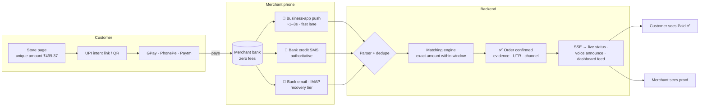

<div align="center">

# 💸 PaidSure

### **Paid? Sure.** — Screenshot-proof UPI payment confirmation for every counter in India

[](LICENSE)
[](https://nodejs.org)
[](https://react.dev)
[](https://kotlinlang.org)
[](https://postgresql.org)
[]()

*No gateway. No fees. No fake screenshots. Your VPA, your bank, your phone — with proof.*

[Quick Start](#-quick-start) · [How It Works](#️-how-it-works) · [Features](#-feature-highlights) · [Roadmap](#-roadmap) · [FAQ](#-faq)

</div>

---

> ⚠️ **The problem every small merchant knows:** a customer shows a "✅ Payment Successful" screen — edited, spoofed, or paid to the wrong VPA — and walks away with the goods. Manual checking stalls the queue. Sound boxes cost a monthly fee. Bank SMS gets missed when a phone's storage is full.

> 💡 **PaidSure fixes it:** every order gets a **unique paise amount** (₹499.**37**, ₹499.**52**…), so when a *₹499.37 credited* alert lands on the merchant's own phone — business-app push, bank SMS, or bank email — the order is **auto-confirmed with evidence**. Screenshots are never trusted. Sound-box behavior, at zero cost.

## 🖼️ What it looks like

**Customer checkout — one clean panel, one action**

```
┌────────────────────────────────────────────────┐
│  Shekar Store                                  │
│  2 × Basmati Rice 5kg                  ₹998    │
│  ─────────────────────────────────────────     │
│  Total to pay                          ₹998.37 │
│                                                │
│  [        Open a UPI app          ]           │
│                                                │
│  Or scan the QR to pay from any device         │
│        ▓▓▓▓▓▓▓▓▓▓▓▓▓▓▓▓▓▓▓▓▓▓▓▓▓▓▓▓▓▓          │
│        ▓▓  ██▀▀██ ▓▓  ██ ▓▓▓ ██▄▄██ ▓▓         │
│        ▓▓▓▓▓▓▓▓▓▓▓▓▓▓▓▓▓▓▓▓▓▓▓▓▓▓▓▓▓▓          │
└────────────────────────────────────────────────┘
```

**Live status — the customer never waits in doubt**

```
   Waiting for payment…  ⏳  →  Payment received — confirming…  🔎  →  ✅ Paid ₹998.37
```

**Merchant dashboard — evidence, not trust**

```
┌ Orders ─────────────────────────────────────────────────────┐
│ #421  ₹998.37   ✅ Paid      via bank SMS + GPay push    2m  │
│ #422  ₹149.52   ⏳ Waiting   expires in 6 min           4m  │
│ #420  ₹79.99    ✅ Paid      via bank email           11m  │
└─────────────────────────────────────────────────────────────┘
```

*Real screenshots land here after Phase 1.*

## ⚙️ How It Works



## ✨ Feature Highlights

| | Feature | What it means for the merchant |
|---|---|---|
| 🔒 | **Screenshot-proof by design** | Confirmation comes only from the merchant's own payment channels |
| ⚡ | **Tri-lane instant capture** | Business-app push (1–3s) → bank SMS → bank email; first match wins, deduped into one payment |
| 🗣️ | **Voice announce (free sound box)** | *“₹549 received, order 421”* spoken on the shop phone, English / Hindi / regional languages |
| 🚨 | **Capture Health + Auto-Fix** | Device heartbeats, 🟢🟡🔴 status, alarm on failure, one-tap FIX NOW wizard verified by a ₹1 self-test |
| 🔋 | **Battery-respectful** | Fully event-driven — no polling, no wake locks; target **< 1.5%/day** |
| 💬 | **WhatsApp payment links** | Create an order → share the link in a chat → auto-confirmed |
| 🕒 | **Late-match window** | A payment that lands late still auto-links to its order within 12 hours |
| 🧾 | **Full evidence ledger** | Every confirmation stores the raw SMS/push, UTR, VPA and channel; unmatched credits never vanish |
| 🏪 | **Multi-merchant platform** | Each merchant gets a store page, dashboard, devices, parser rules and strict/instant confirm mode |

## 🧱 Tech Stack

| Layer | Tech | Piece it plays |
|---|---|---|
| Backend API | **Node + Express + TypeScript** | Orders, intent/QR, ingest, SSE |
| Database | **PostgreSQL + Prisma** | Merchants, orders, evidence, parser rules |
| Parser engine | Rule-based pattern engine | Bank SMS/push formats; a new bank is a new rule, not a rebuild |
| Frontend | **React + Vite**, Apple-grade design tokens | Store checkout, live status, dashboards |
| Android | **Kotlin** — notification listener + SMS receiver | Capture, alarms and TTS, auto-fix wizard |
| Realtime | Server-Sent Events | Live status and confirmation feeds |

## 📁 Repo Structure

```
paid-sure/
├── backend/                  # Express API
│   ├── src/routes/           # orders · ingest · webhooks · admin
│   ├── src/services/         # amount-engine · parser · matcher · evidence
│   ├── src/db/               # prisma schema + migrations
│   └── .env.example
├── frontend/                 # React (Vite)
│   ├── src/pages/store/      # customer checkout + live status
│   ├── src/pages/dashboard/  # merchant + platform admin
│   └── src/design/           # design tokens (clean, Apple-grade system)
├── android/                  # PaidSure Alerts (Kotlin)
│   ├── capture/              # notification listener + SMS receiver
│   ├── alert/                # alarms · TTS · auto-fix wizard
│   └── net/                  # ingest client · offline queue · heartbeat
├── docs/                     # bank SMS format notes · architecture
└── .github/                  # CI · issue templates
```

## 🚀 Quick Start

```bash
git clone https://github.com/aravind220806/paid-sure.git
cd paid-sure

# 1 — backend
cd backend && npm install
cp .env.example .env         # DATABASE_URL · JWT_SECRET · DEVICE_TOKEN_SECRET
npx prisma migrate dev && npm run dev    # → http://localhost:4000

# 2 — frontend
cd ../frontend && npm install && npm run dev   # → http://localhost:5173

# 3 — android helper
# open android/ in Android Studio → run on the shop phone → pair via dashboard QR
```

<details>
<summary><b>🔧 Environment variables</b></summary>

| Variable | Used by | Description |
|---|---|---|
| `DATABASE_URL` | backend | PostgreSQL connection string |
| `JWT_SECRET` | backend | Merchant dashboard sessions |
| `DEVICE_TOKEN_SECRET` | backend | Android pairing tokens |
| `VITE_API_URL` | frontend | Backend base URL |
| `ADMIN_PASSWORD` | backend | Platform-admin access |

</details>

## ⚡ Performance Targets

| Metric | Target | How |
|---|---|---|
| Confirmation latency (fast lane) | **< 3–5 s** | Business-app notification capture |
| Fallback confirmation | **< 60 s** | Bank SMS parser |
| Android battery impact | **< 1.5%/day** | Event-driven design; quiet-hour throttling |
| Concurrent orders per merchant | **1,000s** | Indexed unique `(merchant, amount_paise)` allocation |

## 🗺️ Roadmap

| Phase | Status | Scope |
|---|---|---|
| **1 · MVP — the money loop** | 🔨 in progress | Orders + unique amounts · parser v1 (top banks) · Android capture · dashboard v1 |
| **2 · Reliability product** | 📋 planned | Capture Health · alarm + auto-fix wizard · battery engineering · WhatsApp links · IMAP tier |
| **3 · SaaS polish & scale** | 🧭 planned | Self-serve sign-up · billing · payer CRM · daily ledger · receipts and printing · deployment |

## ❓ FAQ

<details>
<summary><b>Is PaidSure a payment gateway?</b></summary><br>
No — and that is the point. Money moves on the public UPI rails into the merchant's own VPA. PaidSure is the <b>verification layer</b>: it proves the money arrived. Zero transaction fees, no settlement waiting, no KYC to start testing.
</details>

<details>
<summary><b>What if notifications are turned off?</b></summary><br>
Layered channels: the business-app push is only the fastest lane — bank SMS and bank email keep working without notification access. Capture Health detects the silence, raises an alarm, and the FIX NOW wizard deep-links to the exact settings screen, proving recovery with a ₹1 self-test.
</details>

<details>
<summary><b>Can a customer fake it?</b></summary><br>
The customer's screen is never a signal. Only an alert received on the <b>merchant's own phone</b> — bank SMS, business-app push, or bank email — can confirm an order, and every order has a unique amount.
</details>

<details>
<summary><b>Why not just use Razorpay?</b></summary><br>
Gateways charge per-transaction fees and add settlement delays. For many counter sales and social sellers, direct-to-VPA with proof is free and instant. PaidSure also works alongside a gateway — it is a verification layer, not a payment rail.
</details>

## 🤝 Contributing

Parser rules for new banks are the easiest high-value contribution — see [docs/bank-formats.md](docs/bank-formats.md). Bug reports that include a **raw sample SMS** (names redacted) are gold.

```bash
npm run lint && npm run test   # before every PR
```

## 📜 License & Disclaimer

MIT — see [LICENSE](LICENSE). PaidSure is not a licensed Payment Service Provider and does not touch NPCI rails; it verifies payments already made to the merchant's own VPA. "UPI", "BHIM", GPay, PhonePe and Paytm are properties of their respective owners. The Android helper reads **the merchant's own device notifications and SMS, with consent**, solely as payment evidence.

---

<div align="center">

**Built for every local merchant in India.** 🛍️

⭐ Star this repo · 🐛 [Report an issue](../../issues) · 💬 [Discussions](../../discussions)

</div>
