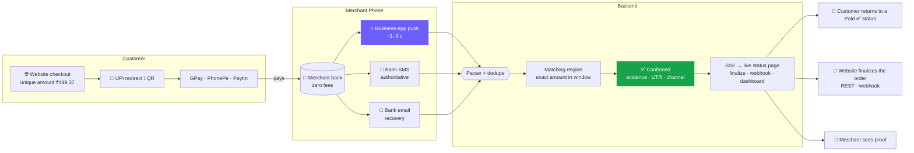
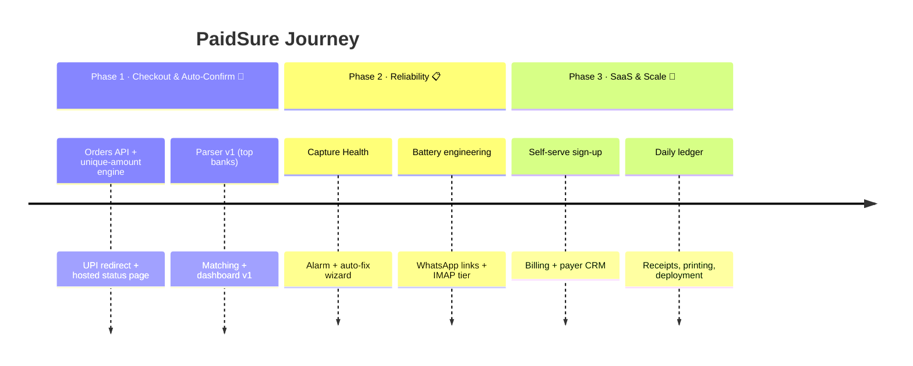

<div align="center">


<a href="https://github.com/aravind220806/Paid_Sure">
  
</a>

<br>

[](LICENSE)
[](https://nodejs.org)
[](https://react.dev)
[](https://kotlinlang.org)
[](#-roadmap)

<br>

**[🚀 Quick Start](#-quick-start)** &nbsp;·&nbsp; **[🎯 Vision](#-vision--goals)** &nbsp;·&nbsp; **[✨ Features](#-features)** &nbsp;·&nbsp; **[⚙️ How It Works](#️-how-it-works)** &nbsp;·&nbsp; **[🗺️ Roadmap](#️-roadmap)** &nbsp;·&nbsp; **[❓ FAQ](#-faq)**

</div>

<br>

## 🧭 At a Glance

PaidSure is a **UPI payment gateway for websites**: your site creates an order with one API call, the customer is redirected to their UPI app with the exact amount, and PaidSure confirms the money actually landed — directly into your bank, with zero gateway fees, finalizing the order only on server-verified evidence.

| | |
|---|---|
| 💰 **Cost** | Zero transaction fees. Checkout funds settle straight into the merchant's own UPI ID (VPA). |
| 🌐 **Integration** | One REST call returns the redirect link, the QR and a hosted live-status page — from any stack. |
| 🔐 **Trust** | A sale is finalized only after verification of the credit from payment evidence — never the customer's screen. |
| ⚡ **Speed** | Customer redirected to any UPI app pre-filled; fast-lane confirmation in ~1–3 seconds. |
| 🔋 **Engine** | Capture runs event-driven on one paired phone — no polling, no wake locks, under 1.5% battery/day. |
| 🇮🇳 **Built for** | Websites, online stores and social sellers in India who need UPI checkout without a gateway contract. |

---

## 🎯 Vision & Goals

> [!NOTE]
> **Vision:** Every website should be able to accept UPI like a licensed gateway — checkout, verification and finalization included — at zero transaction cost.

**Why this matters.** Taking UPI payments on a website today means either a gateway contract (per-transaction fees, KYC, settlement delay) or trusting screenshots and manual checks. PaidSure takes the third path: the order is created through an API, the customer pays on the public UPI rails straight into the merchant's VPA, and only verified credit evidence finalizes the order.

**Goals**

- 🌐 **Make website integration trivial.** One `POST /api/orders` call, one redirect, any stack.
- 🎯 **Make the finalize step trustworthy.** Server-side verification makes a fake success screen worthless.
- 🔌 **Keep the checkout provider-free.** No PSP contract, no MDR, no settlement window.
- 🎯 **Stay reliable when things break.** Three independent capture channels so one failure never blocks confirmations.
- 🧠 **Be easy to extend.** A new bank is a new parser rule, not a rebuild.
- 🏪 **Grow into a SaaS platform.** Self-serve sign-up, billing, payer CRM and daily ledgers for many merchants.

---

## 👥 Who It's For

| Audience | What PaidSure gives them |
|---|---|
| 🌐 **Websites & online stores** | Drop-in UPI checkout: redirect to any UPI app, auto-verified, finalized server-side |
| 🛍️ **Social sellers & small brands** | Shareable checkout links (WhatsApp/DMs) that confirm themselves |
| 🏪 **Kirana stores, stalls, canteens** | The same checkout as a counter QR mode — proof for every sale, free voice announce |
| 🧑‍💻 **Developers & contributors** | A clean REST checkout API callable from any stack, with a hosted status page included |

---

## ⚙️ How It Works

Every order passes through four steps:

1. **Your website creates the order.** One call to `POST /api/orders` returns a unique amount (₹499.**37**), a `upi://` redirect link, a QR and a hosted live-status page.
2. **The customer pays.** Your site redirects them — or shows the QR — and any UPI app (GPay, PhonePe, Paytm) opens pre-filled with the amount. They return to your site.
3. **The payment self-reports.** The paired capture phone collects the credit evidence: business-app push, bank SMS or bank email.
4. **PaidSure verifies and you finalize.** An exact-amount match marks the order PAID with evidence stored (UTR, VPA, channel); your backend reads the status (REST) or the webhook/SSE and releases the goods.



---

## ✨ Features

<table>
<tr>
<td width="33%" valign="top">

### 🌐 Drop-in checkout
One API call returns the UPI redirect link, the QR and a hosted status page — for any website or stack.

</td>
<td width="33%" valign="top">

### ↪️ Redirect flow
The customer opens GPay / PhonePe / Paytm pre-filled with the exact amount, pays, and lands back on your site.

</td>
<td width="33%" valign="top">

### 🔒 Verified finalize
A sale is finalized only from server-side verified evidence — never from the customer's screen.

</td>
</tr>
<tr>
<td width="33%" valign="top">

### 📡 Status + webhook
Live SSE status on the hosted page, plus a REST endpoint and webhook so your backend can finalize the order.

</td>
<td width="33%" valign="top">

### 🚨 Capture Health
Self-healing capture engine: heartbeats, 🟢🟡🔴 status, failure alarms and a **FIX NOW** wizard verified by a ₹1 self-test.

</td>
<td width="33%" valign="top">

### 💬 WhatsApp checkout links
Shareable order links for social selling that confirm themselves.

</td>
</tr>
<tr>
<td width="33%" valign="top">

### 🕒 Late-match window
A payment that arrives late still links to its order within **12 hours**.

</td>
<td width="33%" valign="top">

### 🧾 Evidence ledger
Raw SMS/push, UTR, VPA and channel stored per payment. Unmatched credits are never lost.

</td>
<td width="33%" valign="top">

### 🏪 Multi-merchant
Store pages, dashboards, strict/instant confirm modes — powered by the event-driven Android capture engine (battery-friendly, no MDR hardware).

</td>
</tr>
</table>

---

## 🧠 Why PaidSure Is Different

> [!IMPORTANT]
> **PaidSure is your website's UPI gateway — checkout, verification and finalization — without ever holding money.** Funds settle directly into the merchant's own VPA on the public UPI rails; PaidSure only proves they arrived and tells your backend when.

| | PaidSure | Typical gateway | Paid sound box |
|---|:---:|:---:|:---:|
| Website integration | **1 API + redirect URL** | SDK + keys + dashboard | N/A |
| Transaction fees | **₹0** | Per transaction | Monthly fee |
| Settlement delay | **None (direct to VPA)** | Days | None |
| Fake screenshot can finalize | **❌ Never** | ❌ Never | ❌ Never |
| Unique amount per order | **✅** | Order ID | ❌ |

---

## 🧱 Tech Stack

| Layer | Technology | Role |
|---|---|---|
| **Backend** | Node · Express · TypeScript | Orders, intent/QR, ingest, live updates |
| **Database** | PostgreSQL · Prisma | Merchants, orders, evidence, parser rules |
| **Parser** | Rule-based patterns | Adds a new bank with a rule, not a rebuild |
| **Frontend** | React · Vite | Hosted checkout, live status page, dashboards |
| **Android** | Kotlin | Notification listener, SMS receiver, alarms, TTS |
| **Realtime** | Server-Sent Events | Live status and confirmation feeds |

---

## 📊 Performance Targets

| Metric | Target | How |
|---|:---:|---|
| ⚡ Fast-lane confirmation | **< 3–5 s** | Business-app notification capture |
| 📩 Fallback confirmation | **< 60 s** | Bank SMS parser |
| 🔋 Battery impact | **< 1.5% / day** | Event-driven design, quiet-hour throttling |
| 🏪 Concurrent orders | **1,000s per merchant** | Indexed unique `(merchant, amount_paise)` allocation |

---

## 🛡️ Security & Privacy

- **Consent first.** The Android helper reads a merchant's own notifications and SMS only with their consent, and only as payment evidence.
- **Evidence stays with the merchant.** Raw messages are used to confirm payments and are not shared.
- **Pairing tokens.** Devices pair with the dashboard using signed device tokens.
- **Redacted samples.** Bug reports ask for SMS samples with names removed.

---

## 🗺️ Roadmap



---

## 🚀 Quick Start

### Prerequisites
- Node.js **20.x or newer**
- A database Prisma supports — **SQLite for quick dev**, PostgreSQL for production
- Later: one paired Android phone (the capture engine) — not needed for the first requests

### 1️⃣ Backend
```bash
git clone https://github.com/aravind220806/Paid_Sure.git
cd Paid_Sure/backend
npm install
cp .env.example .env          # set DATABASE_URL, JWT_SECRET, DEVICE_TOKEN_SECRET
npx prisma db push            # quick dev setup (SQLite)
npm run dev                   # → http://localhost:4000
```

### 2️⃣ Hosted checkout & dashboard (frontend)
```bash
cd ../frontend
npm install
npm run dev                   # → http://localhost:5173
```

### 3️⃣ Integrate your website *(ships with Phase 1)*
```bash
curl -X POST http://localhost:4000/api/orders \
  -H 'Content-Type: application/json' \
  -d '{"store":"shekar-store","amount":998,"note": "2 × Basmati Rice 5kg"}'
# → {
#     "ref":         "PS-000421",
#     "redirectUrl": "upi://pay?pa=shekar@upi&am=998.37&...",
#     "statusUrl":   "https://.../s/PS-000421"
#   }
```
Redirect the customer to `redirectUrl` (or render `statusUrl` as a QR). When
they return from the UPI app, your backend confirms via the status endpoint/
webhook and finalizes — always server-side.

### 4️⃣ Capture engine (Android helper)
Open `android/` in Android Studio, run it on the receiving phone, then pair it
from the dashboard QR code.

<details>
<summary><b>🔧 Environment variables</b></summary>

<br>

| Variable | Used by | Description |
|---|---|---|
| `DATABASE_URL` | Backend | SQLite file (dev) or PostgreSQL DSN (prod) |
| `JWT_SECRET` | Backend | Merchant dashboard sessions |
| `DEVICE_TOKEN_SECRET` | Backend | Android capture-pairing tokens |
| `ADMIN_PASSWORD` | Backend | Platform admin access |
| `VITE_API_URL` | Frontend | Backend base URL |

</details>

---

## 📁 Project Structure

```
paid-sure/
├── backend/                 # Express API
│   ├── src/routes/          # orders · ingest · webhooks · admin
│   ├── src/services/        # amount-engine · parser · matcher · evidence
│   └── src/db/              # Prisma schema + migrations
├── frontend/                # React (Vite)
│   ├── src/pages/store/     # customer checkout + live status
│   ├── src/pages/dashboard/ # merchant + platform admin
│   └── src/design/          # design tokens
├── android/                 # PaidSure Alerts (Kotlin)
│   ├── capture/             # notification listener + SMS receiver
│   ├── alert/               # alarms · TTS · auto-fix wizard
│   └── net/                 # ingest client · offline queue · heartbeat
└── docs/                    # bank SMS formats · architecture · banner.svg
```

---

## ❓ FAQ

<details>
<summary><b>Is PaidSure a payment gateway?</b></summary>

<br>

For your website it **behaves like one**: an order API, a UPI redirect checkout, a status endpoint and a finalize webhook. The difference is underneath — it's not a licensed PSP, so money never passes through it. Payments settle straight into the merchant's own VPA: no MDR, no settlement window, no KYC to start testing.

</details>

<details>
<summary><b>What happens after the customer returns?</b></summary>

<br>

Your site lands them on a hosted live-status page (SSE). Under the hood, PaidSure matches the verified credit evidence to the order and flips it to PAID — your backend reads that through the status REST endpoint or the finalize webhook, then ships the goods. The customer's screen is never treated as proof.

</details>

<details>
<summary><b>What if notifications are turned off?</b></summary>

<br>

Bank SMS and bank email keep working without notification access. Capture Health detects the silence and raises an alarm. The FIX NOW wizard opens the right settings screen and confirms recovery with a ₹1 self-test.

</details>

<details>
<summary><b>Can a customer fake it?</b></summary>

<br>

No. The customer's screen is never used as a signal. Only an alert received on the **merchant's own phone** can confirm an order, and every order has a unique amount.

</details>

<details>
<summary><b>Why not just use Razorpay?</b></summary>

<br>

Gateways charge per-transaction fees and hold funds until settlement. For websites that only need UPI, checkout direct-to-VPA is free and instant, with the order confirmed by bank-grade evidence. PaidSure also coexists with an existing gateway — it's just the UPI checkout + verification layer.

</details>

---

## 🤝 Contributing

Contributions are welcome. The easiest high-value contribution is a **parser rule for a new bank**. See [`docs/bank-formats.md`](docs/bank-formats.md).

> [!TIP]
> Bug reports that include a **raw sample SMS** (with names redacted) are the most helpful kind.

```bash
npm run lint && npm run test   # run before every PR
```

---

## 📜 License & Disclaimer

Released under the [MIT License](LICENSE).

> [!CAUTION]
> PaidSure is **not** a licensed Payment Service Provider and does not touch NPCI rails. It provides the checkout and verification for payments already made to the merchant's own VPA, and never holds or moves money. "UPI", "BHIM", GPay, PhonePe and Paytm belong to their respective owners.

---

<div align="center">


**UPI checkout for every website** 🌐

⭐ Star this repo &nbsp;·&nbsp; 🐛 [Report an issue](../../issues) &nbsp;·&nbsp; 💬 [Discussions](../../discussions)

</div>
