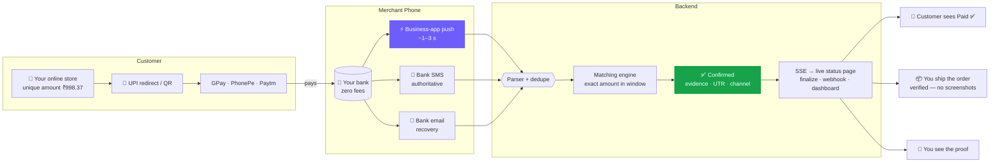
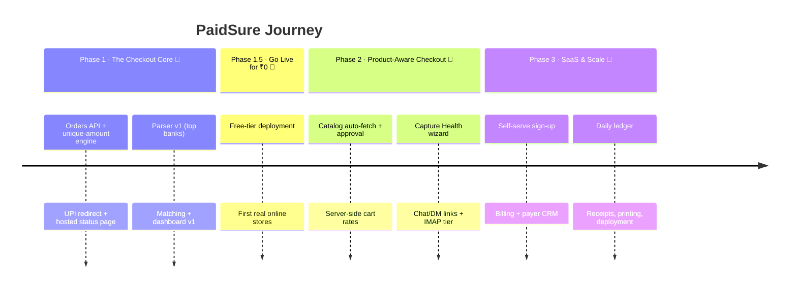

<div align="center">


<a href="https://github.com/aravind220806/Paid_Sure">
  
</a>

<br>

[](LICENSE)
[](https://nodejs.org)
[](https://react.dev)
[](https://kotlinlang.org)
[](#-roadmap)

<br>

**[🚀 Quick Start](#-quick-start)** &nbsp;·&nbsp; **[🎯 Vision](#-vision--goals)** &nbsp;·&nbsp; **[👥 Who It's For](#-who-its-for)** &nbsp;·&nbsp; **[⚖️ Other Gateways vs PaidSure](#-other-gateways-vs-paidsure)** &nbsp;·&nbsp; **[✨ Features](#-features)** &nbsp;·&nbsp; **[⚙️ How It Works](#️-how-it-works)** &nbsp;·&nbsp; **[☁️ Cloud or Self-Host](#-cloud-or-self-host)** &nbsp;·&nbsp; **[🤖 One-Paste AI Setup](#-one-paste-ai-setup)** &nbsp;·&nbsp; **[🗺️ Roadmap](#️-roadmap)** &nbsp;·&nbsp; **[❓ FAQ](#-faq)**

</div>

<br>

## 🧭 At a Glance

PaidSure is a **UPI payment gateway made for small online product sellers**: your website creates the order, your customer pays in any UPI app, and the sale is finalized only after the money is **verified in your own bank** — zero gateway fees, instant settlement, no contract.

| | |
|---|---|
| 💰 **Cost** | ₹0 per transaction. A sale of ₹499 shouldn't lose ₹10–15 to gateway fees. Funds settle straight into your own UPI ID (VPA). |
| 🌐 **Integration** | Paste one link/button, or call one REST API. Works with any site builder, WordPress, or custom code — any stack. |
| 🏦 **Money** | It's your bank account, not ours. Nothing is held back for days: the customer's payment *is* your money, immediately. |
| 🔐 **Trust** | A sale is finalized only after the credit is verified from payment evidence (UTR, amount, channel) — never from the customer's screen. |
| 🛒 **Product-aware** | *(Phase 2)* Sync your product list once and every cart fills with the correct names and rates automatically — no manual amounts again. |
| 🇮🇳 **Built for** | Small online product sellers in India — the audience the big gateways price out. |

---

## 🎯 Vision & Goals

> [!NOTE]
> **Vision:** Every small online seller should get payment checkout as good as a big marketplace — verified, automatic, and free.

**Why this matters.** Big gateways are built for big merchants: per-transaction fees, KYC paperwork, settlement delays, SDKs that assume a dev team. When you sell products online and your margin on a sale is ₹50, a ₹10 gateway fee plus a 3-day settlement wait hurts. The alternative today — manual UPI and screenshot checks — invites fraud. PaidSure is the third path: **your website, your products, your bank, and a gateway that only flips a switch when the money is verified.**

**Goals**

- 🛒 **Make selling online self-serve.** A pasted button for simple sites; one `POST /api/orders` for real code. Both get the same verified checkout.
- 🧾 **Make the checkout know your products.** Catalog sync feeds product names and rates into the cart automatically (Phase 2).
- 🎯 **Make the finalize step trustworthy.** Server-side verification makes a fake success screen worthless.
- 🔌 **Keep checkout provider-free.** No PSP contract, no MDR, no settlement window, no KYC to start.
- 🔁 **Stay reliable when things break.** Three independent capture channels so one failure never blocks confirmations.
- 🧠 **Be easy to extend.** A new bank is a new parser rule, not a rebuild.

---

## 👥 Who It's For

| Audience | What PaidSure gives them |
|---|---|
| 🛍️ **Small online product sellers** *(primary)* | A real checkout for a small shop: product links that open any UPI app pre-filled, confirmed automatically, money straight to their bank |
| 🌐 **Anyone building a website with products** | One API call → redirect → verified webhook; no gateway contract needed to start |
| 💬 **Social sellers (DM / chat orders)** | Shareable checkout links that confirm themselves — no screenshot trust |
| 🧑‍💻 **Developers & contributors** | A clean REST checkout API callable from any stack, with a hosted live-status page included |

---

## ⚖️ Other Gateways vs PaidSure

**What other gateways ask from a small online seller:**

| What other gateways do | What it costs you |
|---|---|
| 💳 Charge per transaction (typically ~2% + platform fees) | ₹499 sale → ~₹10–15 gone, every single sale |
| 🕐 Hold your money in settlement windows | You ship today; the money arrives days later |
| 📄 KYC, agreements, approvals before you can test | Selling starts *next week*, not today |
| 🧩 SDKs and keys that assume a developer on the payroll | Simple sites are left out |
| 🤳 Accept the customer's success screen as proof | Fake screenshots become *your* loss |
| 🔒 Decide your pricing on their pricing page | Fees grow as you grow |

**What PaidSure does instead:**

| | PaidSure |
|---|---|
| 💸 Fees | **₹0 — money moves directly to your VPA on public UPI rails** |
| ⏱️ Settlement | **None. The customer's payment lands in your bank instantly** |
| 📝 Signing up | **Your UPI ID is the merchant account. No PaidSure-owned account exists** |
| 🌐 Integration | **One pasted link/button, or one API call — your choice** |
| 🎭 Fake screenshots | **Worthless. Only verified credit evidence on the paired phone finalizes an order** |
| 🔢 Amounts | **Every order gets a server-assigned unique paise amount (₹998.37) — receipts can't collide** |
| 🧾 Prices in the cart | *(Phase 2)* **Synced from your catalog — rates are computed server-side, customers can't edit them** |
| 📜 Open source | **MIT. Self-host the whole gateway on your own machine for free, forever** |

> [!IMPORTANT]
> **PaidSure acts like a gateway for your website — checkout, verification, finalization — but never holds or moves money.** It's not a licensed PSP, so no fees flow through it: funds go card-free and intermediary-free, straight from the customer's UPI app to your bank.

---

## ✨ Features

<table>
<tr>
<td width="33%" valign="top">

### 🌐 Drop-in checkout
One API call returns the UPI redirect link, the QR and a hosted status page — for any website or stack.

</td>
<td width="33%" valign="top">

### ↪️ Redirect flow
The customer opens GPay / PhonePe / Paytm pre-filled with the exact amount, pays, and lands back on your site.

</td>
<td width="33%" valign="top">

### 🔒 Verified finalize
A sale is finalized only from server-side verified evidence — never from the customer's screen.

</td>
</tr>
<tr>
<td width="33%" valign="top">

### 📡 Status + webhook
Live SSE status on the hosted page, plus a REST endpoint and webhook so your backend can finalize the order.

</td>
<td width="33%" valign="top">

### 🛒 Product-aware cart *(Phase 2)*
Sync your product names and rates once; carts self-fill and totals are computed server-side — no manual amounts.

</td>
<td width="33%" valign="top">

### 💬 Shareable checkout links
Per-order payment links for chat and DM sales that confirm themselves.

</td>
</tr>
<tr>
<td width="33%" valign="top">

### 🚨 Capture Health
Self-healing capture engine: heartbeats, 🟢🟡🔴 status, failure alarms and a **FIX NOW** wizard verified by a ₹1 self-test.

</td>
<td width="33%" valign="top">

### 🕒 Late-match window
A payment that arrives late still links to its order within **12 hours**.

</td>
<td width="33%" valign="top">

### 🧾 Evidence ledger
Raw SMS/push, UTR, VPA and channel stored per payment. Unmatched credits are never lost.

</td>
</tr>
</table>

---

## ⚙️ How It Works

Every order passes through four steps:

1. **Your website creates the order.** One call to `POST /api/orders` returns a unique amount (₹998.**37**), a `upi://` redirect link, a QR and a hosted live-status page. *(No code? Paste a checkout link instead.)*
2. **The customer pays.** Your site redirects them — or shows the QR — and any UPI app (GPay, PhonePe, Paytm) opens pre-filled with the amount. They return to your site.
3. **The payment self-reports.** Your paired capture phone collects the credit evidence: business-app push, bank SMS or bank email. *(The ~1–3 s fast lane needs a UPI business app with its payment notifications ON — see [What you need](#-what-you-need). SMS/email keep working without it.)*
4. **PaidSure verifies and you finalize.** An exact-amount match marks the order PAID with evidence stored (UTR, VPA, channel); your backend reads the status (REST) or the webhook/SSE and ships the product.



---

## ☁️ Cloud or Self-Host

Same code, two ways to run it — pick the one that fits how you sell:

| | ☁️ **Cloud (Model A)** | 🖥️ **Self-Host (Model B)** |
|---|---|---|
| Who runs the gateway | The hosted PaidSure instance — sign up, paste your VPA, done | **You** — clone this repo and run it on your own machine or server |
| Who has the data | The hosted instance | **Your machine. Your database, your rules** |
| Effort | Minutes | ~10 minutes with the [AI setup prompt](#-one-paste-ai-setup) below |
| Cost | Free tiers | ₹0 — any computer you already own; your existing server can host it beside your website |
| Best for | Sellers who just want a link that works | Sellers who want full control, privacy, or to run it on their own hosting |

> [!NOTE]
> **Security rule in both models:** the Android helper never talks to the database — it talks only to the gateway's API with a signed device token. Database credentials live on the server, in one place, never inside any app.

---

## 🤖 One-Paste AI Setup

Don't want to follow the steps yourself? Copy the box below and paste it into any AI coding assistant (Claude Code, Cursor, Copilot, or a chat agent with access to your computer). It clones the project, sets everything up, connects your store, and proves it works — asking you only what only you can answer.

```text
Set up PaidSure for me — the free open-source UPI payment gateway from
https://github.com/aravind220806/Paid_Sure

PaidSure lets a small online product seller accept UPI payments on their
website with zero transaction fees. Money goes directly to MY UPI ID.
This tool only confirms that the money arrived. Never do anything that
costs money. If a step asks for a card or payment details, STOP and tell me.

Work on this computer and do these steps in order. Say each step in one
short, simple sentence before you do it, so I always know what's happening:

1. CLONE — Download the project into a folder named "PaidSure".
2. INSTALL — Install everything it needs (check that Node.js 20+ exists
   first; if missing, tell me how to install it).
3. PREPARE THE DATABASE — Create a local database file and a settings file
   with three randomly generated secrets. Keep my settings on this computer
   only; never print them or send them anywhere.
4. START THE GATEWAY — Start it and check the health page says ok. If
   something fails, read the error, fix it, and retry yourself.
5. START THE DASHBOARD — Start the website part and give me the exact
   address to open in my browser.
6. ASK ME ONLY WHAT ONLY I KNOW:
   - My store name
   - My UPI ID (where I receive money, like name@okaxis)
   - Do I have my own website, or should I use PaidSure's hosted pages?
7. CONNECT THE CHECKOUT:
   - If I have a website: add the smallest working example to MY website
     (match its language and framework) so it creates an order, sends the
     customer to the UPI app, and finalizes when PaidSure reports the
     payment as verified.
   - If I have no website: show me how to create an order and a checkout
     link from the dashboard.
   - If my website lists products with prices: also prepare a product list
     file (name, price, product link) so the catalog sync in Phase 2 can
     consume it — see the Roadmap section.
8. CONNECT MY PHONE — Walk me through installing the "PaidSure Alerts"
   Android app on the phone that receives my bank SMS, and scanning the
   pairing code from the dashboard. Wait for me to finish.
9. PROVE IT WORKS — Create a ₹1 test order, have me pay it from any UPI
   app, and confirm the order flips to PAID by itself. Show me the payment
   proof on screen.

RULES:
- Ask questions ONLY when only I can answer (my UPI ID, my choices). Fix
  everything else yourself.
- Keep all passwords, keys and tokens on this computer only.
- Never connect any mobile app directly to the database — apps talk only
  to the gateway's API.
- When done, give me a simple one-page summary:
  (a) what is running where, (b) how to start it next time,
  (c) how to update it with one command, (d) where to get help.
```

---

## 🧱 Tech Stack

| Layer | Technology | Role |
|---|---|---|
| **Backend** | Node · Express · TypeScript | Orders, intent/QR, ingest, live updates |
| **Database** | Prisma · SQLite (dev) / PostgreSQL (prod) | Merchants, products, orders, evidence, parser rules |
| **Parser** | Rule-based patterns | Adds a new bank with a rule, not a rebuild |
| **Frontend** | React · Vite | Hosted checkout, live status page, dashboards |
| **Android** | Kotlin | Notification listener, SMS receiver, alarms, TTS |
| **Realtime** | Server-Sent Events | Live status and confirmation feeds |

---

## 📊 Performance Targets

| Metric | Target | How |
|---|:---:|---|
| ⚡ Fast-lane confirmation | **< 3–5 s** | Business-app notification capture |
| 📩 Fallback confirmation | **< 60 s** | Bank SMS parser |
| 🔋 Battery impact | **< 1.5% / day** | Event-driven design, quiet-hour throttling |
| 🛒 Concurrent orders | **1,000s per merchant** | Indexed unique `(merchant, amount_paise)` allocation |

---

## 🛡️ Security & Privacy

- **Consent first.** The Android helper reads a merchant's own notifications and SMS only with their consent, and only as payment evidence.
- **Evidence stays with the merchant.** Raw messages are used to confirm payments and never shared.
- **Pairing tokens.** Devices pair with the dashboard using signed device tokens, stored hashed server-side.
- **Redacted samples.** Bug reports ask for SMS samples with names removed.

---

## 🗺️ Roadmap



---

## 📋 What You Need

PaidSure doesn't process money, so getting paid-ready needs **your own accounts plus one phone**:

| # | Requirement | Why |
|---|---|---|
| 1️⃣ | **Your own UPI ID (VPA)** — e.g. `yourstore@okaxis` | Checkout funds settle directly here. No PaidSure-owned account ever exists. |
| 2️⃣ | **A bank account that sends credit SMS/alerts** | The authoritative confirmation lane. |
| 3️⃣ | **One Android phone** (the receiving/SIM phone) | Runs **PaidSure Alerts**, the capture engine — event-driven, ~1.5% battery/day. |
| 4️⃣ | **A UPI business app with notifications ON** — Google Pay for Business, PhonePe Business or Paytm for Business, holding your VPA, with "payment received" notifications enabled | This is the **fast lane**: "you received ₹X" pushes in ~1–3 seconds. |
| 5️⃣ | **PaidSure Alerts paired** (dashboard QR pairing) | Captures push + SMS evidence and reports device health. |

> [!IMPORTANT]
> **Notifications ON is the one switch that makes PaidSure instant.** If it's ever off, you don't lose correctness — bank SMS and bank email still confirm (slower) — and **Capture Health** catches the silence, sounds the alarm, and the **FIX NOW** wizard deep-links to the exact settings screen, proving recovery with a ₹1 self-test.

---

## 🚀 Quick Start

### Prerequisites
- Node.js **20.x or newer**
- A database Prisma supports — **SQLite for quick dev**, PostgreSQL for production
- For live end-to-end: the items in [📋 What you need](#-what-you-need) — a VPA and a capture phone with a UPI business app (notifications ON)
- Not needed for your first local requests

### 1️⃣ Backend
```bash
git clone https://github.com/aravind220806/Paid_Sure.git
cd Paid_Sure/backend
npm install
cp .env.example .env          # set DATABASE_URL, JWT_SECRET, DEVICE_TOKEN_SECRET
npx prisma db push            # quick dev setup (SQLite)
npm run dev                   # → http://localhost:4000
```

### 2️⃣ Hosted checkout & dashboard (frontend)
```bash
cd ../frontend
npm install
npm run dev                   # → http://localhost:5173
```

### 3️⃣ Integrate your website *(ships with Phase 1)*
```bash
curl -X POST http://localhost:4000/api/orders \
  -H 'Content-Type: application/json' \
  -d '{"store":"your-store","amount":998,"note":"2 × Graphic Tee"}'
# → {
#     "ref":         "PS-000421",
#     "redirectUrl": "upi://pay?pa=yourstore@okaxis&am=998.37&...",
#     "statusUrl":   "https://.../s/PS-000421"
#   }
#                              ^^^^^^ .37 = server-assigned unique paise
```
Redirect the customer to `redirectUrl` (or render `statusUrl` as a QR). When
they return from the UPI app, your backend confirms via the status endpoint/
webhook and finalizes — always server-side.

### 4️⃣ Capture engine (Android helper)
Open `android/` in Android Studio, run it on the receiving phone, then pair it
from the dashboard QR code.

<details>
<summary><b>🔧 Environment variables</b></summary>

<br>

| Variable | Used by | Description |
|---|---|---|
| `DATABASE_URL` | Backend | SQLite file (dev) or PostgreSQL DSN (prod) |
| `JWT_SECRET` | Backend | Merchant dashboard sessions |
| `DEVICE_TOKEN_SECRET` | Backend | Android capture-pairing tokens |
| `ADMIN_PASSWORD` | Backend | Platform admin access |
| `VITE_API_URL` | Frontend | Backend base URL |

</details>

---

## 📁 Project Structure

```
paid-sure/
├── backend/                 # Express API
│   ├── src/routes/          # orders · ingest · webhooks · admin
│   ├── src/services/        # amount-engine · parser · matcher · evidence
│   └── src/db/              # Prisma schema + migrations
├── frontend/                # React (Vite)
│   ├── src/pages/store/     # customer checkout + live status
│   ├── src/pages/dashboard/ # merchant + platform admin
│   └── src/design/          # design tokens
├── android/                 # PaidSure Alerts (Kotlin)
│   ├── capture/             # notification listener + SMS receiver
│   ├── alert/               # alarms · TTS · auto-fix wizard
│   └── net/                 # ingest client · offline queue · heartbeat
└── docs/                    # bank SMS formats · architecture · banner.svg
```

---

## ❓ FAQ

<details>
<summary><b>Is PaidSure a payment gateway?</b></summary>

<br>

For your website it **behaves like one**: an order API, a UPI redirect checkout, a status endpoint and a finalize webhook. The difference is underneath — it's not a licensed PSP, so money never passes through it. Payments settle straight into the merchant's own VPA: no MDR, no settlement window, no KYC to start testing.

</details>

<details>
<summary><b>What happens after the customer returns?</b></summary>

<br>

Your site lands them on a hosted live-status page (SSE). Under the hood, PaidSure matches the verified credit evidence to the order and flips it to PAID — your backend reads that through the status REST endpoint or the finalize webhook, then ships the goods. The customer's screen is never treated as proof.

</details>

<details>
<summary><b>What if notifications are turned off?</b></summary>

<br>

Bank SMS and bank email keep working without notification access. Capture Health detects the silence and raises an alarm. The FIX NOW wizard opens the right settings screen and confirms recovery with a ₹1 self-test.

</details>

<details>
<summary><b>Can a customer fake it?</b></summary>

<br>

No. The customer's screen is never used as a signal. Only an alert received on the **merchant's own paired phone** can confirm an order, and every order has a unique amount — fake receipts and reused screenshots have nothing to match.

</details>

<details>
<summary><b>Why not just use Razorpay?</b></summary>

<br>

Gateways are priced for high volume — but if your whole margin on a ₹499 sale is ₹50, a ~2% fee plus settlement days is a real cost. PaidSure exists for the sellers those pricing pages ignore: direct-to-VPA checkout at ₹0 per transaction, confirmed by verified bank evidence. It can also coexist with an existing gateway — it's just the UPI checkout + verification layer.

</details>

<details>
<summary><b>Do I need a developer to set this up?</b></summary>

<br>

No. Simple sites use the paste-a-link tier (no code), and self-hosting is a one-paste job for an AI assistant — see [One-Paste AI Setup](#-one-paste-ai-setup). The API tier is there when you want code.

</details>

---

## 🤝 Contributing

Contributions are welcome. The easiest high-value contribution is a **parser rule for a new bank**. See [`docs/bank-formats.md`](docs/bank-formats.md).

> [!TIP]
> Bug reports that include a **raw sample SMS** (with names redacted) are the most helpful kind.

```bash
npm run lint && npm run test   # run before every PR
```

---

## 📜 License & Disclaimer

Released under the [MIT License](LICENSE).

> [!CAUTION]
> PaidSure is **not** a licensed Payment Service Provider and does not touch NPCI rails. It provides the checkout and verification for payments already made to the merchant's own VPA, and never holds or moves money. "UPI", "BHIM", GPay, PhonePe and Paytm belong to their respective owners.

---

<div align="center">


**UPI checkout for small online product sellers** 🛒

⭐ Star this repo &nbsp;·&nbsp; 🐛 [Report an issue](../../issues) &nbsp;·&nbsp; 💬 [Discussions](../../discussions)

</div>
